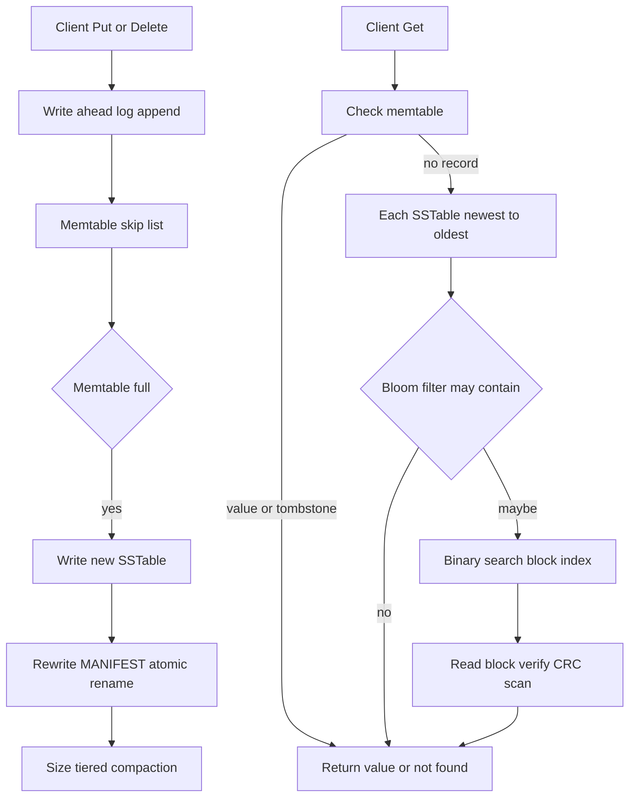

# strata

[](https://github.com/yashtalikhede/strata/actions/workflows/ci.yml)
[](https://pkg.go.dev/github.com/yashtalikhede/strata)
[](LICENSE)

An embedded, ordered key-value store built as a log-structured merge tree in Go,
from scratch, on the standard library alone.

## What it is

strata is an educational storage engine, written to understand how an LSM-tree
works by building every piece of one: a skip-list memtable, a checksummed
write-ahead log, immutable sorted tables with their own indexes and Bloom
filters, a manifest, and size-tiered compaction.

It has no dependencies outside the Go standard library, not even for testing,
and it is a single-process embedded store rather than a server. The interesting
part is not the throughput: it is that a `kill -9` at any moment leaves the
database openable with exactly the writes that were acknowledged, and that
there are tests which demonstrate that rather than a README which claims it.

## Features

- **Skip-list memtable** with `Put`, `Get` and `Delete`, ordered bytewise, with
  the empty key valid.
- **Write-ahead log** with a CRC-32C over every record, covering the length
  field so a corrupt length is never acted on, and recovery that truncates a
  torn tail rather than refusing to open.
- **Immutable sorted tables** with a block index, a per-block CRC and a Bloom
  filter, so a lookup for an absent key usually costs no disk read at all.
- **MANIFEST** describing which tables are live, replaced by a single atomic
  rename that serves as the commit point for both a flush and a compaction.
- **Size-tiered compaction** that merges runs of similarly sized tables, keeps
  the newest version of each key, and drops a tombstone only when the merge
  reaches the oldest table.
- **Directory lock** so only one process can open a database at a time.
- **Command-line tool** with one-shot commands, an interactive shell and a
  built-in benchmark harness.
- **Public Go API** that is a thin facade over the engine.

## Quick start

### As a library

```
go get github.com/yashtalikhede/strata
```

```go
package main

import (
	"errors"
	"fmt"
	"log"

	"github.com/yashtalikhede/strata"
)

func main() {
	store, err := strata.Open("/tmp/mydb", nil)
	if err != nil {
		log.Fatal(err)
	}
	defer store.Close()

	if err := store.Put([]byte("colour"), []byte("blue")); err != nil {
		log.Fatal(err)
	}

	value, err := store.Get([]byte("colour"))
	if errors.Is(err, strata.ErrNotFound) {
		fmt.Println("no such key")
	} else if err != nil {
		log.Fatal(err)
	} else {
		fmt.Printf("colour is %s\n", value)
	}

	if err := store.Delete([]byte("colour")); err != nil {
		log.Fatal(err)
	}
}
```

More, including the options, is in the [package documentation](https://pkg.go.dev/github.com/yashtalikhede/strata).

### As a command

```
go build -o bin/strata ./cmd/strata     # or: go run ./cmd/strata
```

A real session, captured from the built binary:

```console
$ strata -dir /tmp/mydb put greeting hello
$ strata -dir /tmp/mydb put colour blue
$ strata -dir /tmp/mydb get greeting
hello
$ strata -dir /tmp/mydb del colour
$ strata -dir /tmp/mydb get colour
not found
(exit 1)
$ strata -dir /tmp/mydb stats
memtable bytes:            0
sstables:                  3
flushes:                   0
compactions:               0
compaction errors:         0
block reads:               0
bloom rejects:             0
flush bytes written:       0
compaction bytes read:     0
compaction bytes written:  0
user bytes written:        0
tombstones dropped:        0
shadowed dropped:          0
write amplification:       0.00
```

Each invocation opens the database and closes it again, so the counters start
from zero every time: `sstables` describes what is on disk, the rest describe
what this process did. The interactive shell keeps one database open for the
session:

```console
$ printf 'put greeting "hello there"\nflush\nput colour blue\nflush\nput shade teal\nflush\ncompact\nget greeting\ndel greeting\nget greeting\nquit\n' | strata -dir /tmp/mydb2 shell
strata> strata> strata> strata> strata> strata> strata> compacted 3 tables into 1
strata> hello there
strata> strata> not found
strata>
```

The prompts bunch together because the input is piped rather than typed. Values
may be double-quoted Go strings, so they can contain spaces.

Commands: `put`, `get`, `del`, `flush`, `compact`, `stats`, `shell`, `bench`,
`version`, `help`. Flags: `-dir` (required by anything touching a database),
`-sync none|always`, `-hex` to read and print keys and values as hex. Flags may
come before or after the command.

## Architecture



A database is one directory:

```
mydb/
  LOCK           flock held for as long as the database is open
  MANIFEST       the live tables, the first live log, and the next file number
  000009.wal     write-ahead log; numbers at or above the manifest's are replayed
  000002.sst     immutable sorted table: data blocks, index, Bloom filter, footer
```

Every file draws its number from one counter, so a number is never reused.

## Durability and crash safety

Under the default `SyncAlways`, a `Put` or `Delete` that returns without error
has been logged and fsynced. It survives the process being killed, and a power
loss provided the operating system and drive honour fsync, which no engine can
verify from inside.

Under `SyncNone`, a write that returns is in the page cache: it survives the
process dying, being killed or panicking, but not a power loss until something
calls `Flush` or a later write pushes it out. `Close` syncs the log either
way.

A flush and a compaction each change the database with exactly one atomic
rename of the manifest. Before it the new files are unreferenced orphans which
the next open deletes and the old state is whole; after it the new state is
whole and the old files are the orphans. There is no moment in between, so
recovery never repairs a half-finished operation, only sweeps up after one.

Honest limitations:

- A log corrupted in the middle, rather than at the end, ends the replay there.
  The format has no block framing to resynchronise with, so every acknowledged
  write after the damage is lost.
- The directory lock uses `flock` and is effective on unix only. On other
  platforms acquiring it always succeeds and nothing stops two processes from
  opening the same database.
- The CRCs detect damage; they do not repair it. There is no redundancy.

## How it is tested

| kind | what it does | how to run |
|---|---|---|
| Unit tests | Per-package behaviour, including tests that pin the on-disk byte layouts | `make test` |
| Model-based randomized | 30,000 operations against a Go map, with a few hundred close-and-reopen cycles, compaction on and off, two fixed seeds | `make test` |
| Fuzz targets | `FuzzReplay`, `FuzzUnmarshal`, `FuzzOpen`, `FuzzManifestDecode` feed arbitrary bytes to every parser that reads untrusted input | `make fuzz` |
| Process-kill | A child writes with `SyncAlways` and prints each acknowledgement; the parent `SIGKILL`s it, reopens, and checks every acknowledged write, four rounds killing at different points | `make test` |
| Fault injection | Hooks at each step of flush and compaction abort with no cleanup, standing in for dying at that instant; each is paired with a reopen | `make test` |
| Race detector | Every test runs under `-race` | `make test` |
| CI | Linux runs the full suite, macOS the short one plus vet, fmt and build | `.github/workflows/ci.yml` |

109 test functions, 4 fuzz targets, 4 runnable examples and 16 benchmarks.
Coverage from `go test -cover ./...`:

| package | coverage |
|---|---|
| `strata` | 100.0% |
| `internal/memtable` | 100.0% |
| `internal/bloom` | 98.0% |
| `internal/compaction` | 95.7% |
| `cmd/strata` | 85.4% |
| `internal/db` | 84.8% |
| `bench` | 82.4% |
| `internal/sstable` | 81.6% |
| `internal/wal` | 79.2% |

`make check` runs the full suite; `make test-short` trims the slowest tests for
a quicker loop; `make cover` reports the table above; `make fuzz` runs each
target for ten seconds.

## Benchmarks

From `bench/results/darwin-arm64.md`: Apple M1, 8 cores, darwin/arm64,
go1.27.2, 500,000 entries of 100-byte values, one thread, log unsynced,
compaction on, 4 MiB memtable, seed 1.

| workload | ops | ops/s | MB/s | p50 | p99 | p99.9 | write-amp | tables | blockreads/op | bloomrejects/op |
|---|---|---|---|---|---|---|---|---|---|---|
| fillseq | 500000 | 176620 | 19.5 | 2.709µs | 13.75µs | 24.541µs | 1.89 | 4 | n/a | n/a |
| fillrandom | 500000 | 163603 | 18.1 | 3.083µs | 15.292µs | 28.75µs | 1.89 | 4 | n/a | n/a |
| overwrite | 500000 | 109448 | 12.1 | 3.125µs | 17.917µs | 52.125µs | 2.68 | 3 | n/a | n/a |
| readhit | 500000 | 291708 | 32.3 | 3.209µs | 7.542µs | 28.833µs | 1.89 | 4 | 0.954 | 1.721 |
| readmiss | 500000 | 1115468 | 17.0 | 750ns | 3.375µs | 5.291µs | 1.89 | 4 | 0.033 | 3.967 |
| mixed | 500000 | 143275 | 15.8 | 3.291µs | 13.333µs | 42.125µs | 2.81 | 2 | n/a | n/a |
| deleterandom | 250000 | 253702 | 3.9 | 3.208µs | 9.25µs | 19.458µs | 1.84 | 5 | 0.000 | 0.000 |

`n/a` is not a missing measurement. The per-operation reader counters are
differences between two snapshots of counters the engine sums over its live
tables, and a compaction retires tables and takes their counts away, so after a
compaction the two snapshots no longer describe the same set. The harness
detects that the compaction count moved and reports `n/a` rather than a figure
it cannot stand behind, which is why the writing workloads have no numbers in
those columns and the read workloads do.

What durability costs, from `bench/results/darwin-arm64-syncalways.md` (3,000
entries, `-sync always`, same machine): `fillrandom` falls from 163603 to 263
operations a second, **622.1x slower**, and its median latency rises from
3.083µs to 3.968709ms. `overwrite` falls from 109448 to 227, **482.1x slower**.
The arithmetic is in [docs/DESIGN.md](docs/DESIGN.md).

Caveats, all of them:

- One machine, one run. These are not reproducible scores.
- No block cache: every hit reads its block from the OS and allocates a buffer.
- Flush and compaction are synchronous under the same lock as writes, so a
  write that triggers one pays for it.
- The main table uses `-sync none`. Durable writes are three orders of
  magnitude slower, as above.
- 100-byte values and 500,000 keys. Other shapes will behave differently.
- The two runs use different entry counts, and the synced run is small enough
  that it never flushed, so it is measuring a log append plus an fsync.

Reproduce with `make bench`, which writes a report named for the platform.

## Design decisions and trade-offs

**A delete is a write.** Nothing is edited in place, so removing a key means
writing a tombstone: a record saying the key is gone. Deleting costs space
rather than reclaiming it, and the tombstone travels through flushes and
compactions like any other record, because an older table may still hold the
value it shadows.

**A tombstone can only be dropped by a compaction that includes the oldest
table.** This is the subtlest rule in the engine. Merge tables 1 to 4 and throw
away a tombstone found there, and table 0 is still underneath holding the value
that tombstone was hiding; the next lookup walks past the merged output, reaches
table 0, and returns a value the caller deleted. Only when the merge reaches the
oldest table is there nothing left to shadow. This is why `strata compact`,
which merges everything, is the only operation guaranteed to reclaim deleted
space.

**The manifest rename is the commit point.** A flush or compaction writes its
new files where nothing references them, then rewrites the manifest with one
atomic rename. That gives a single instant at which the change becomes true, so
nothing before it needs undoing and nothing after it may fail in a way that
matters. Updating several files in order would need a recovery procedure for
each intermediate state.

**Size-tiered rather than leveled compaction.** Tables are grouped into size
classes and a class with enough of them is merged. It is simpler and writes
fewer bytes than a leveled scheme, at the cost of consulting more tables on a
read and rewriting whole tables rather than key ranges. The write amplification
of 1.89 on a fill is the visible half of that trade.

**Bloom filters at 10 bits per key with 7 hash functions.** Seven is not a free
choice: the optimal count is the bits per key times ln 2, which for ten bits
rounds to seven. The measured false-positive rate is 0.8390% (839 of 100,000
absent keys, from `go test -run TestFalsePositiveRate -v ./internal/bloom`), so
about one lookup in a hundred for a key that was never written pays for a block
read it did not need. One hash is computed and split in two, with the i-th bit
taken as `h1 + i*h2`, which costs one hash instead of seven for the same rate.

**Interleaved odd and even keys in the miss benchmark.** The keys a workload
writes are even numbers; the absent keys it probes are the odd numbers between
them. If the absent keys came from past the end of the key space, every table's
index would reject them by comparing against its first key and the Bloom filters
would never be consulted, so the benchmark would measure the index instead of
the filter.

## Limitations and future work

- Flush and compaction run synchronously inside the write lock, so they stall
  every writer and reader for as long as they take.
- No block cache. Every hit reads a block from the operating system and
  allocates a fresh buffer for it.
- No range scans, iterators or snapshots in the public API. A caller can look
  one key up and nothing else.
- No leveled compaction and no key-range partitioning, so a compaction rewrites
  whole tables.
- No compression and no prefix compression, in blocks or in the index.
- One process per directory, and the lock only works on unix.
- The log has no block framing, so a replay cannot resynchronise after damage
  in the middle of a file.

Plausible next steps, in rough order of value: background flush and compaction
with a second memtable taking writes; a merging iterator for range scans and
snapshots; a block cache; block compression; block framing in the log.

## Project layout

```
.                      public API: a thin facade over internal/db
bench/                 deterministic benchmark harness and committed results
cmd/strata/            command-line tool
internal/memtable/     skip-list write buffer
internal/wal/          checksummed write-ahead log
internal/bloom/        Bloom filter with persistence
internal/sstable/      immutable sorted tables: writer, reader, iterator
internal/compaction/   k-way merge with newest-wins and tombstone dropping
internal/db/           the engine: flush, recovery, manifest, lock, compaction
docs/DESIGN.md         how it works and why, at length
```

## Development

| target | what it does |
|---|---|
| `make check` | gofmt, vet, the full test suite under `-race`, and a build |
| `make test` | the full test suite under `-race` |
| `make test-short` | the suite with the slowest tests trimmed |
| `make cover` | per-package coverage |
| `make fuzz` | each fuzz target for ten seconds |
| `make bench` | a full benchmark run, written to `bench/results/` |
| `make build` | the `strata` binary into `bin/` |

## License

MIT. See [LICENSE](LICENSE).
